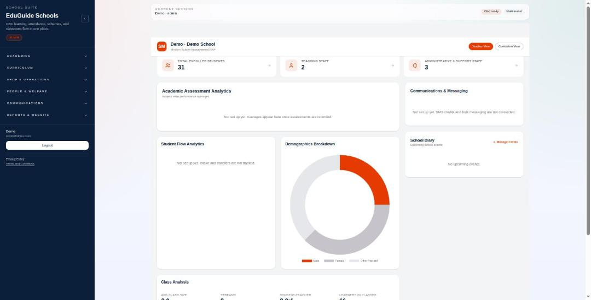
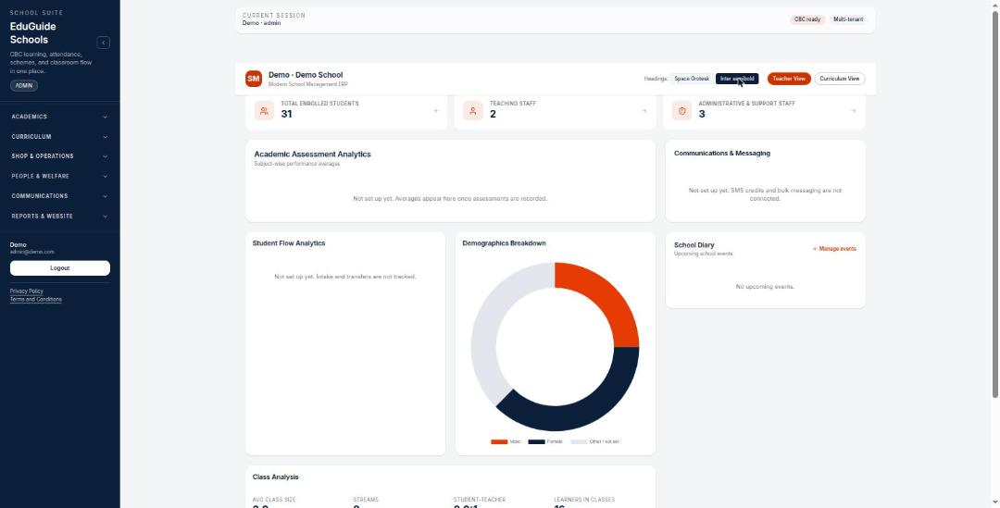
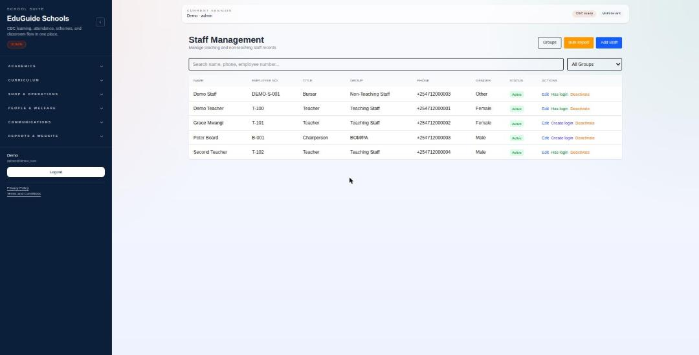
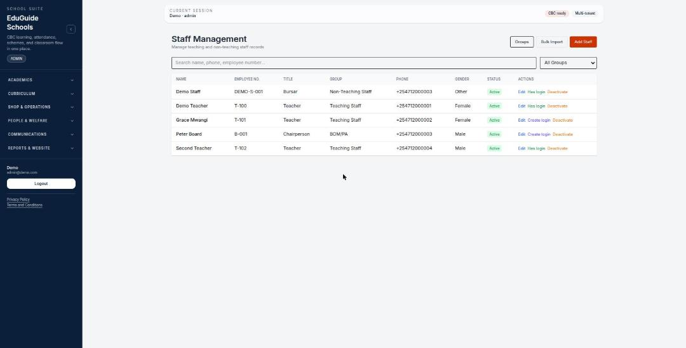
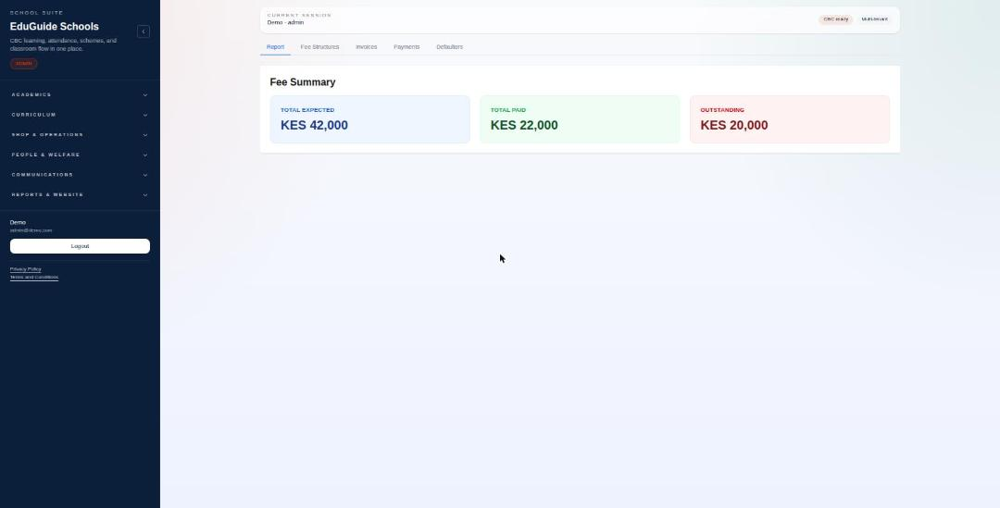
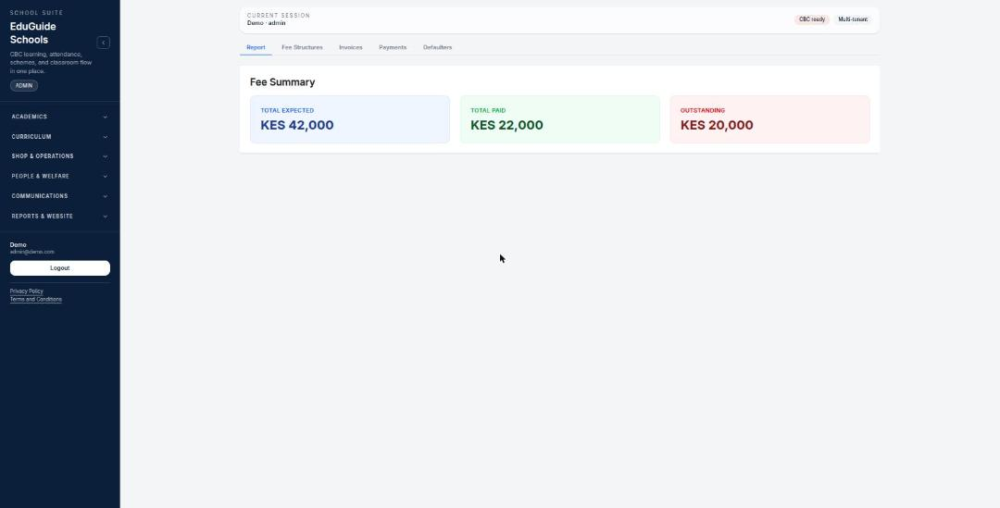
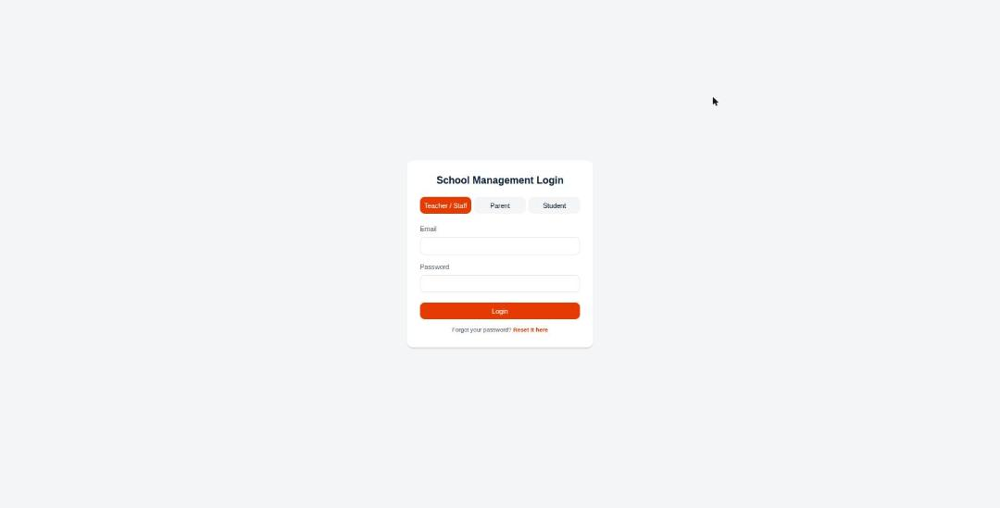
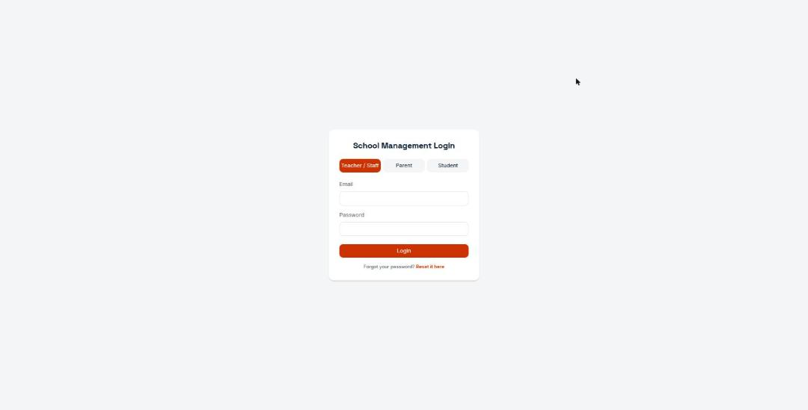

# UI refresh, step 1: tokens, fonts, nav, buttons (2026-11-19)

Branch `feat/ui-refresh` (frontend), from `feat/school-data-management`. Direction: Learning Pack brand (same tokens as the bookshop BRAND set) and the updated "School Admin Dashboard" canvas. Local dev servers, seed `admin@demo.com`, 1440x900. Not pushed.

## What changed
- **Tokens, defined once** in `src/index.css` (`:root` + Tailwind `@theme`): orange `#E63B00` (brand, highlights, large text), button orange `#CC3300` with hover `#B32D00` (white text, AA), navy `#0B1F3A`, body text `#202124`, muted `#5A6170`, line `#E3E6EC`, page `#F4F5F7`, secondary-button hover `#E8EBF0`, and status colours (ok / warn / danger, each with a soft background) reserved for meaning. Components use the generated names (`bg-brand-button`, `text-brand-muted`, `bg-status-warnSoft`...). Existing `brand-*` names keep working.
- **Fonts:** Inter 400-700 for body; headings use `--heading-font`. Aptos is gone. Both heading options are live on the Dashboard header ("Headings: Space Grotesk | Inter semibold"); the choice is remembered in the browser. Pick one and I remove the toggle.
- **Page:** the gradient background is now flat `#F4F5F7`; keyboard focus ring is 2px navy everywhere.
- **Buttons:** white-text buttons across 51 files moved from `#E63B00` / blue / teal / green / indigo to `#CC3300`. The amber "Bulk Import" style buttons became secondary (grey, navy text, thin border). Red (delete) is unchanged because it carries meaning.
- **Nav:** still navy; active item is `#CC3300`; hover is a white wash, not orange; section labels are 12px with tighter tracking and more contrast; role pill and icon tiles are neutral; width capped at 288px (was 384px at xl).
- **Dashboard:** chart colours are read from the CSS tokens instead of repeating hex values.

## Screenshots
| Page | Before | After |
|---|---|---|
| Dashboard (Space Grotesk) |  |  |
| Dashboard (Inter semibold) | |  |
| Staff |  |  |
| Fees |  |  |
| Login |  |  |

The Login shots were taken with the form emptied: the browser autofills a saved login there, and I did not use or capture it.

## Not done yet (step 2 onward)
- Several primary actions can still appear on one screen (for example Dashboard "Teacher View" plus nav active state; Parents "Add parent" plus others). One orange primary per screen needs a shared Button component, not a class swap.
- Status colours are still used as decoration: Fees summary tiles (blue / green / red pastels), Staff row links (blue / green / amber text), Fees tabs (blue), tinted `bg-*-100` badges (about 150 uses).
- Literal hex values remain: 56 in `.jsx` (charts, a few inline styles, landing pages) and 3 `bg-[#...]` classes. 2 files still use blue/teal/green 600-700 backgrounds outside buttons.
- Dashboard "Teacher View / Curriculum View" pills do nothing; the "CURRENT SESSION" strip and "Multi-tenant" pill are still there.
- Table, card, empty-state and page-header components, and the content width cap, are step 2.
