# UI refresh, step 2: Button, status colours, tokens, Dashboard header (2026-11-19)

Branch `feat/ui-refresh` (frontend), pushed. Space Grotesk headings are applied and the font toggle is gone. Local dev servers, seed `admin@demo.com`, 1440x900. Root pointer not bumped (frontend stays off `feat/school-data-management` only on this branch).

## What changed
- **Shared components:** `components/ui/Button.jsx` (primary / secondary / danger / link, sm / md, optional `to`) and `components/ui/StatusBadge.jsx` (ok / warn / danger / neutral). Their colours come from `.btn-*` classes in `index.css`, built only from tokens. `utils/tokens.js` reads tokens for Chart.js and Leaflet.
- **Status colours only for meaning:** a palette sweep across 68 files moved raw Tailwind colours to tokens. Greens, reds and ambers became `status-ok / warn / danger`; blues, purples, teals and similar tints became neutral navy or grey; greys became `brand-muted / charcoal / line / grayLight`. On the audited pages: Fees tiles are neutral and Outstanding turns red only when it is above 0; Staff row links are neutral (the green "Has login" is now muted text); Active/Inactive uses `StatusBadge`; Parents "Add child" is no longer green. Active tabs and selected pills are navy, so the orange button is the only orange on screen.
- **One primary per screen:** Staff (Add Staff), Parents (Add Parent), Classes (New Class: the duplicate in the table header is gone), Students (the add-learner button; "Print Broad Sheet" is secondary).
- **Literal hex:** 56 down to 14. Events category dots, Gradebook radar, bus/driver maps and the pickup marker now use tokens. The 14 left are the School Website builder's per-school branding colours (user data, not our palette).
- **Dashboard:** the Teacher View / Curriculum View pills did nothing, so they are removed. The header showed the literal text "Demo School" to every school because `user.school` is an id; it now loads the real school name from `/api/tenants/schools/`. Fixed the sticky header offset that overlapped the metric cards on desktop, and the stray `<sectionHeader>` element.

## Screenshots
| Page | Before | After |
|---|---|---|
| Dashboard | 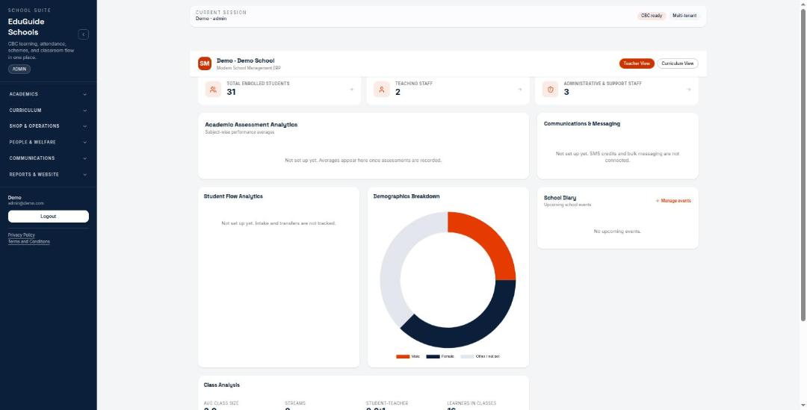 | 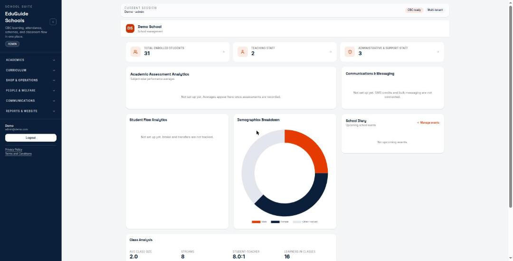 |
| Staff | 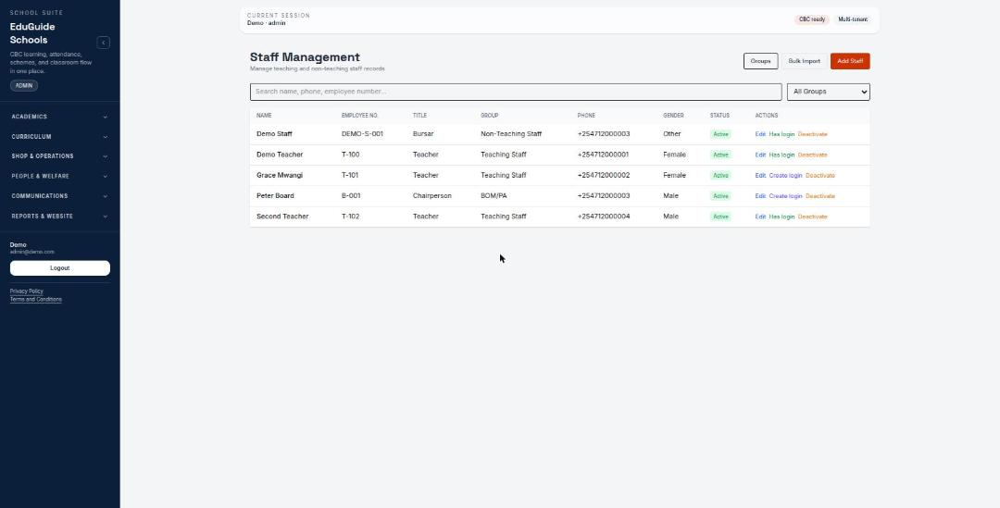 | 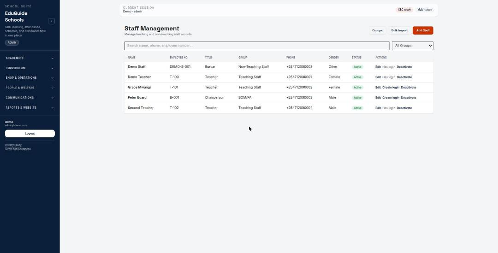 |
| Classes | 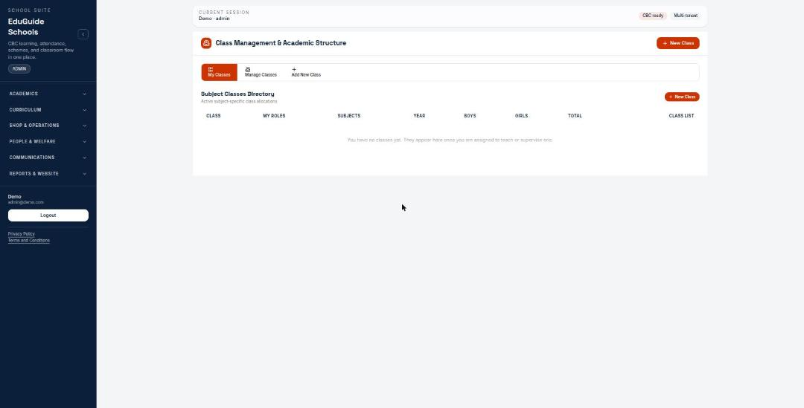 | 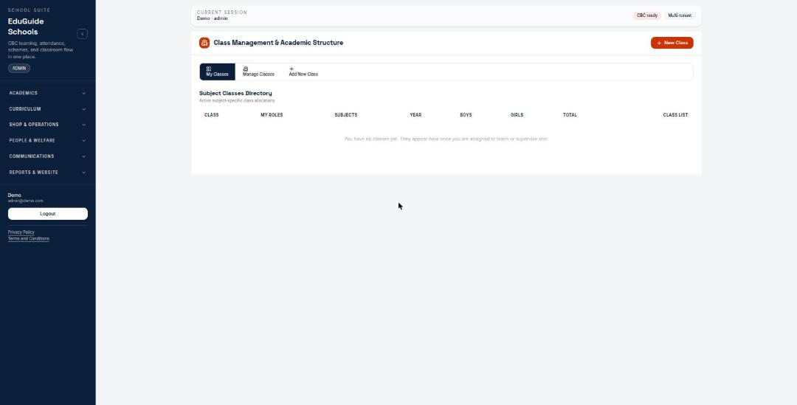 |
| Students | 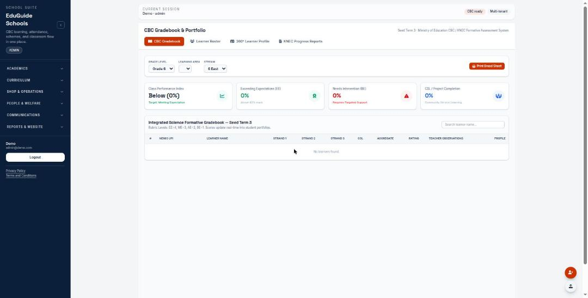 | 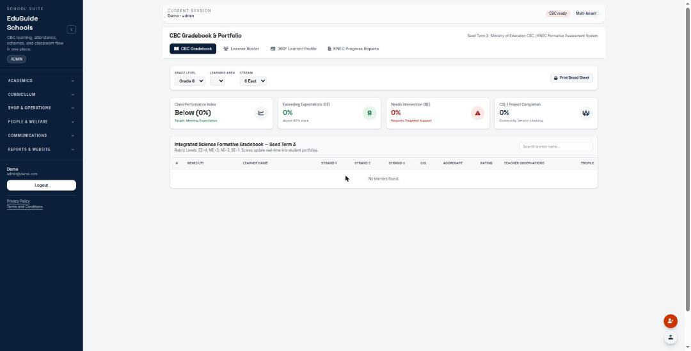 |
| Parents | 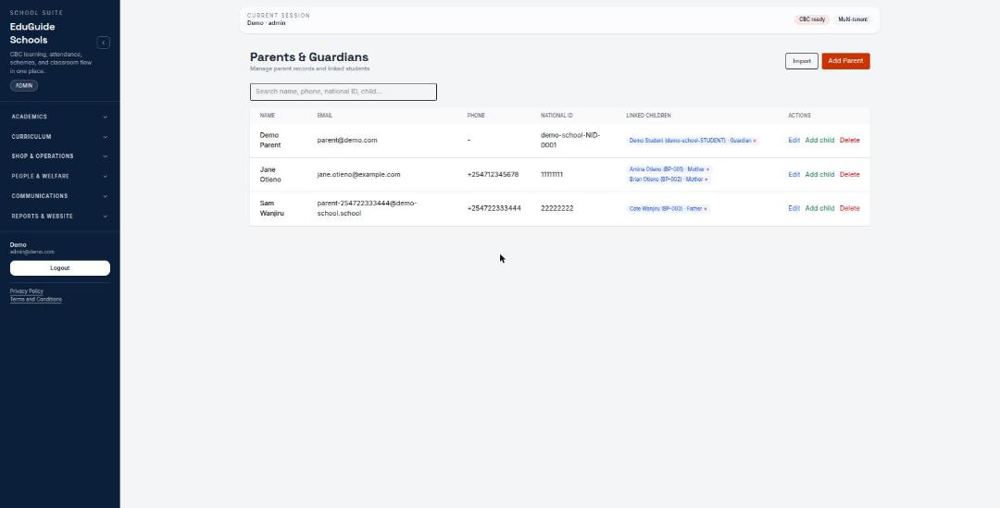 | 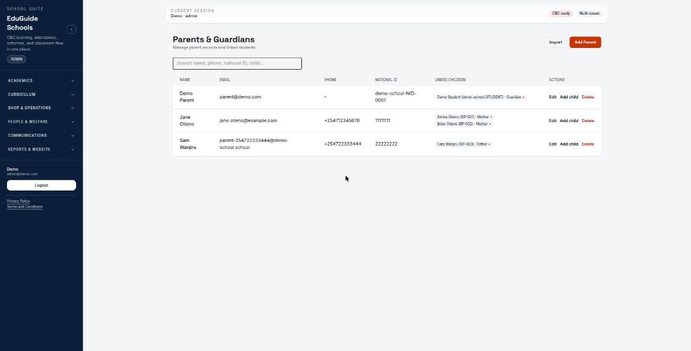 |
| Fees | 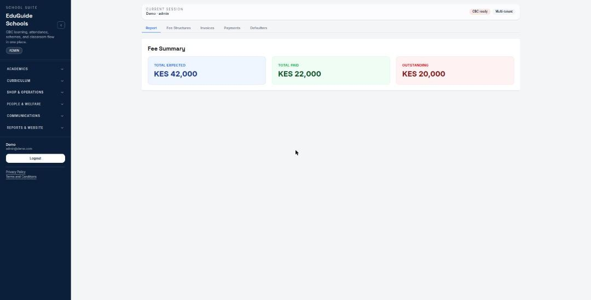 | 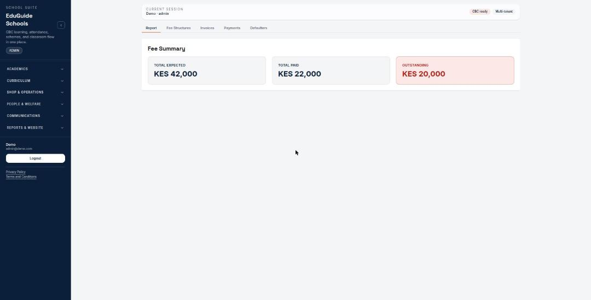 |

No console errors on the six pages; `vite build` passes.

## Limits (honest)
- `<Button>` is used in Staff and Parents only. Classes, Students/Gradebook, Fees and the other ~60 pages still use token-coloured utility classes on plain `<button>`; adopting the component there is mechanical but touches every screen.
- The palette sweep was automatic and cannot tell decoration from meaning: about 550 `status-*` uses remain across the app, many on pages I did not review, so some decorative green/red/amber will still show. 219 raw palette classes remain (mostly `text-*-300/400` on dark panels and solid `bg-red-600` / `border-red-400` for errors).
- Pages I did not open after the sweep (everything outside the six) were only compile-checked, not eyeballed.
- The "CURRENT SESSION" strip and "CBC ready / Multi-tenant" pills are still in the header; table width cap and card/empty-state components are not done.
